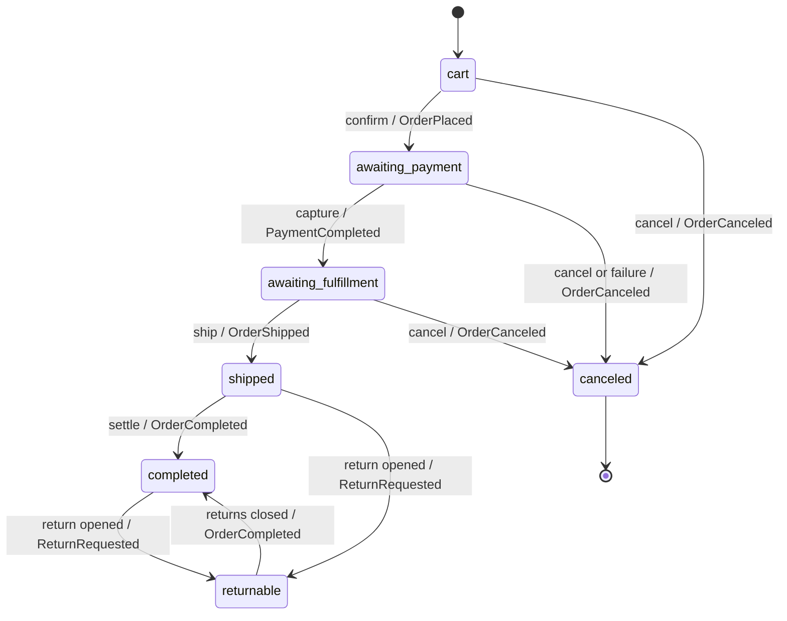

# Order Lifecycle

The order aggregate, its locked state machine, the three-step checkout, address handling, the adjustment model, computed totals, and the outbox write that makes every transition durable.

**Links:** [Promotion engine](./04-promotion-engine.md) · [Tax engine](./05-tax-engine.md) · [Inventory model](./06-inventory-model.md) · [Module contracts](./02-module-contracts.md) · [Data flow](../01-overview/03-data-flow.md) · [Orders requirements](../../01-requirements/02-functional/02-orders.md) · [Architecture index](../README.md) · [Spec](../../11-spec/README.md)

---

## Purpose

The Orders module owns one aggregate root, `Order`, and the only mechanism that may change its
status: a locked state machine. This file defines that aggregate, enumerates every legal
transition with its trigger and emitted event, describes the delivery → payment → confirm checkout
that drives the forward path, fixes the adjustment model and the totals formula, and states the
outbox rule that commits each event with the state change it describes. Promotion effects are
`03/02-04`; tax is `03/02-05`; stock effects are `03/02-06`; the end-to-end annotated flow is
`03/01-03`.

The single rule that holds this file together: **a state transition is the only status mutator, and
every transition writes its domain event to the outbox in the same transaction.**

---

## The Order Aggregate

`Order` is the aggregate root. It exclusively owns:

| Part | Shape | Notes |
|---|---|---|
| `Order` | root | store scope, currency, state, number, timestamps, `RowVersion`. |
| `LineItem` | child | references a variant; captures the `Money` unit price at add-time; positive quantity. |
| `ShipAddress` | value snapshot | copied onto the order; later edits to a saved address do not rewrite history. |
| `BillAddress` | value snapshot | defaults to the ship address unless overridden. |
| `Adjustment` | child | promotion and shipping discounts, plus manual corrections (see the adjustment model below). |

The order is bound to exactly one `Store` and one ISO-4217 currency for its entire lifecycle
(`FR-ORD-012`). A line item total is always computed as `unit price × quantity` and is never a
cached column. Adding the same variant again increments the existing line item rather than creating
a duplicate (`FR-ORD-002`).

---

## State Machine

Forward states are `cart → awaiting_payment → awaiting_fulfillment → shipped → completed`. Side
states are `canceled` and `returnable`. The table below is the complete transition set; a
transition not listed here is rejected with a conflict error, and no other code path mutates status
(`FR-ORD-004`).

| State | Allowed transitions | Trigger | Emitted event |
|---|---|---|---|
| `cart` | → `awaiting_payment` | Checkout confirm passes all gates. | `OrderPlaced` |
| `cart` | → `canceled` | Cart/order canceled before payment. | `OrderCanceled` |
| `awaiting_payment` | → `awaiting_fulfillment` | Payment captured successfully. | `PaymentCompleted` |
| `awaiting_payment` | → `canceled` | Cancellation, or terminal payment failure per store policy. | `OrderCanceled` |
| `awaiting_fulfillment` | → `shipped` | Admin fulfills and ships. | `OrderShipped` |
| `awaiting_fulfillment` | → `canceled` | Admin cancel before shipment. | `OrderCanceled` |
| `shipped` | → `completed` | All shipments delivered and the order is settled. | `OrderCompleted` |
| `shipped` | → `returnable` | Returns module opens a return authorization. | `ReturnRequested` |
| `completed` | → `returnable` | Returns module opens a return within the return window. | `ReturnRequested` |
| `returnable` | → `completed` | All open returns are closed. | `OrderCompleted` |
| `canceled` | — (terminal) | — | — |

`completed` is **not terminal**: it is a settled resting state that can still open a return window
and move `→ returnable` (`FR-ORD-009`).

`PaymentCompleted` is the Orders-facing name for the outcome of a successful capture; the Payments
module emits `PaymentAuthorized`/`PaymentCaptured` and Orders advances on the captured outcome
(`03/02-02`). The `→ returnable` transitions are initiated by the Returns module but executed
through the Orders state machine, so the order remains the single writer of its status.



---

## Checkout Steps

Checkout is a three-step flow operating on the same aggregate that later becomes the placed order
(`01/02-03` is the checkout FR set; the public API is `09/03-03`). Each
step is gated so a shopper cannot skip ahead, and revisiting an earlier step invalidates the
results of later steps.

| Step | Gate to advance | Side effects inside the step |
|---|---|---|
| delivery | Valid shipping address; at least one offered method; a method selected. | Quotes methods via `IShippingRateService`; writes one shipping adjustment; re-evaluates shipping-method promotion rules; recomputes tax on post-promotion amounts. |
| payment | A successful authorization or capture outcome. | Sends the freshly computed server total to the gateway; records a payment attempt with the gateway reference and outcome; never stores PAN/CVV. |
| confirm | Delivery and payment complete; idempotency key not already used. | Reserves stock; locks final promotion adjustments; computes tax a final time; transitions the order; writes the outbox row — all in one transaction. |

**Confirm is the critical transaction.** It verifies the earlier steps and the idempotency key,
reserves stock (`03/02-06`), recomputes and locks promotion adjustments (`03/02-04`), computes tax
on the post-promotion amount (`03/02-05`), performs the `cart → awaiting_payment` transition (then
`→ awaiting_fulfillment` on immediate capture), and writes the transition events to the outbox in
the same transaction. If any line cannot be reserved, the whole confirm fails and the order stays in
`cart` (`FR-CHK-004`, `FR-CHK-006`).

---

## Address Handling

- The **shipping address** is required before the order may leave the delivery step; the **billing
  address** is required before payment is attempted.
- Billing defaults to the shipping address unless the shopper overrides it (`FR-ORD-003`).
- An address is **snapshotted onto the order** at the moment it is set: a later edit to a saved
  customer address never rewrites an order's history.
- A guest may enter a new address; a signed-in customer may select a saved address or enter a new
  one. Addresses are store-scoped and validated before shipping methods are quoted.
- Changing the shipping address or the line items invalidates a now-invalid shipping selection and
  re-quotes methods, then recomputes adjustments and tax (`FR-CHK-002`, `FR-TAX-004`).

---

## Adjustment Model

An `Adjustment` is an additive row attached to the order and, optionally, to one line item. It
records a **signed** `Money` amount and the source that produced it.

| Field | Type | Meaning |
|---|---|---|
| `Id` | `AdjustmentId` | Identity. |
| `OrderId` | `OrderId` | Owning order. |
| `LineItemId` | `LineItemId?` | `null` for order-scoped; set for line-item-scoped. |
| `Amount` | `Money` (signed) | Shipping costs are positive; promotion discounts are negative; a manual correction may be either sign. |
| `Source` | enum | `promotion`, `shipping`, or `manual`. |
| `SourceReference` | string | Promotion id + action key, shipping method id, or admin operation reference. |
| `Label` | string | Human-readable description shown on the order. |
| `CreatedAtUtc` | instant | Recorded through `IClock`. |

Rules:

1. **Never tax.** The valid sources are `promotion`, `shipping`, and `manual`. Tax is *not* an
   adjustment source: it is a separate computed component (see below and `03/02-05`).
2. **Scoped.** A promotion may produce line-item-scoped adjustments, order-scoped adjustments, or
   both; a shipping selection produces one order-scoped adjustment; a manual admin correction may
   be line-item- or order-scoped.
3. **Clamped per line.** A discount never drives a line below zero; the clamped amount, not the
   requested amount, is recorded (`FR-PRM-005`).
4. **Additive and immutable once placed.** Changing or disabling a promotion does not mutate
   adjustments already recorded on a placed order (`FR-ORD-005`, `FR-PRM-006`).
5. **Captured prices are never edited.** A promotion changes effective amounts through adjustments,
   never by rewriting a line item's captured unit price.

---

## Computed Totals

No total is ever cached in a single column. The authoritative formula, recomputed on every
contributing change, is:

```
itemTotal       = Σ (lineItem.unitPrice × lineItem.quantity)
adjustmentTotal = Σ adjustments            (signed: shipping +, promotion discounts −, manual ±)
tax             = tax computed on post-promotion amounts        (see 03/02-05)
total           = itemTotal + adjustmentTotal + tax
```

`adjustmentTotal` excludes tax by construction: tax is returned by `ITaxCalculationService` as its
own breakdown and is summed separately. This formula is stated for exclusive-tax stores; in a
tax-inclusive store, tax is contained within the item and adjustment amounts rather than added on
top, and the engine reports it as a component of those amounts (`05-tax-engine.md`). All parts are
`Money` in the order's store currency; an attempt to attach a `Money` of a different currency is
rejected (`FR-ORD-012`). Totals are recomputed whenever a line item, adjustment, shipping
selection, promotion, or address changes, including at each checkout step (`FR-ORD-006`,
`FR-CHK-009`).

---

## Outbox Write

Every state transition writes its domain event to the outbox table **in the same transaction** as
the state change, stock reservation, payment record, and adjustment writes it accompanies. The
Orders module uses `IOutboxWriter` (`03/02-02`) inside the confirm/fulfillment transaction; after
commit the unit of work publishes the events through `IDomainEventDispatcher` — a publish failure
never throws and leaves the row undelivered — and the `OutboxRelayService` delivers or replays
the row and marks it delivered (`03/01-03`).

- Delivery is **at-least-once**; consumers (email, analytics) must be idempotent.
- If the process restarts after commit but before dispatch, the event is still delivered by the
  relay; a direct dispatch followed by a relay replay invokes each handler once, because the
  inbox dedupes per `(EventId, HandlerType)`.
- An isolated failed payment attempt is recorded against the order but advances no state and emits
  no transition event.
- The outbox row carries at least `StoreId`, `OccurredAtUtc` (via `IClock`), and the minimum
  identifiers a consumer needs.

## Open Questions

1. Whether a manual adjustment requires a reason code and is restricted to store admins is owned by
   the admin order API `03/04-02`; `manual` is a first-class total-affecting source here, and tax is
   never one.
2. ~~The exact outbox relay/consumer split (in-process dispatcher versus dedicated worker)~~ —
   **resolved** (BuildingBlocks CQRS + Outbox + Event Store — Design Spec): each transition's
   outbox write is followed by direct in-process dispatch after commit, with the
   `OutboxRelayService` worker replaying anything the dispatch missed; the same-transaction write
   rule here is unaffected. One line only — the mechanism is `03/01-03`.
3. Whether capture is immediate at payment or deferred to fulfillment is a per-store checkout
   option owned by `03/02-02` (Payments/Orders contracts); both paths preserve the single confirm
   transaction.

## Links

- [Promotion engine](./04-promotion-engine.md)
- [Tax engine](./05-tax-engine.md)
- [Inventory model](./06-inventory-model.md)
- [Module contracts](./02-module-contracts.md)
- [Data flow](../01-overview/03-data-flow.md)
- [Orders requirements](../../01-requirements/02-functional/02-orders.md)
- [Checkout requirements](../../01-requirements/02-functional/03-checkout.md)
- [Design spec](../../11-spec/README.md) — §6 (order aggregate,
  adjustments, totals).
- [ADR 0002 — Modular monolith](../../00-governance/01-adr/02-modular-monolith.md)
- Entity model and domain-event catalogue: `03/03-01`; public API reference: `09/03-03`.
