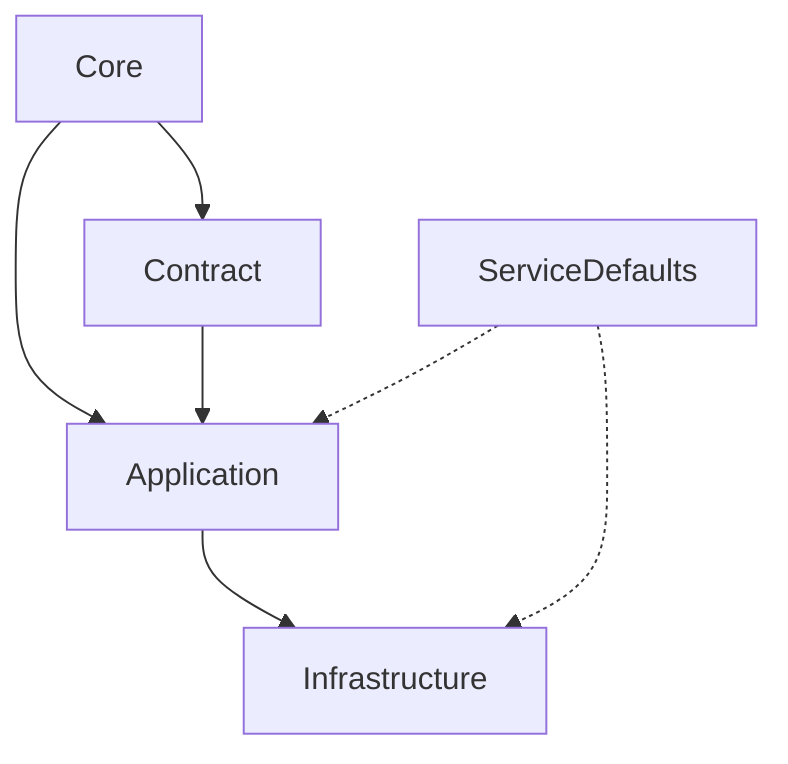

# src

Source code for QingFa.Shop — production libraries and applications. _layer_

## Summary

This folder contains all production code organized by architectural layer:
- **Core** — Domain primitives, shared kernel, and cross-cutting abstractions.
- **Contract** — Public DTOs, events, and API contracts shared across services.
- **Application** — Use cases, commands, queries, and application services.
- **Infrastructure** — External adapters (EF Core, Redis, Wolverine, Stripe, Email, S3).
- **ServiceDefaults** — Shared Aspire configuration (OTel, resilience, service discovery, health checks).

Applications live in `../app/`.

## Contains

| Path | Role | Notes |
|---|---|---|
| `Core/` | layer · kernel | Domain primitives, value objects, events, interfaces |
| `Contract/` | layer · api | Public DTOs, events, MediatR messages, FluentValidation rules |
| `Application/` | layer · service | Use cases, command/query handlers, mappers, policies |
| `Infrastructure/` | layer · adapter | EF Core, Redis, Wolverine, Stripe, Email, S3, HealthChecks |
| `ServiceDefaults/` | layer · shared | Aspire service configuration, OTel, resilience policies |

## Boundaries

In scope:
- All production .NET libraries and their internal organization.
- Layer-specific dependency rules (enforced by architecture tests).

Out of scope:
- Runnable applications → see [`../app/`](../app/).
- Test code → see [`../tests/`](../tests/).
- Frontend (Vue) projects → see [`../app/Web.Storefront/`](../app/Web.Storefront/), [`../app/Web.Admin/`](../app/Web.Admin/).
- Build configuration → see [`../Directory.Build.props`](../Directory.Build.props), [`../Directory.Packages.props`](../Directory.Packages.props).

## Assumptions

- All projects target `net10.0` (see [`../global.json`](../global.json)).
- Central Package Management via [`../Directory.Packages.props`](../Directory.Packages.props).
- Nullable reference types enabled; warnings as errors.
- Projects reference only layers they depend on (see dependency diagram below).

## Invariants

- **Core** has zero external dependencies (only `FluentValidation`, `Mapster`, `Mediator.Abstractions`, `Slugify.Core`).
- **Contract** depends only on Core and .NET BCL (no MediatR in Contract — use `Mediator.Abstractions` if needed).
- **Application** depends on Core + Contract; never on Infrastructure.
- **Infrastructure** depends on Core + Contract + Application + ServiceDefaults.
- **ServiceDefaults** has no project references (only NuGet packages).

## Contracts

- `Core` → [`AssemblyMarker`](../src/Core/Assembly.Marker.cs) anchors the assembly.
- `Contract` → Public DTOs, `ICommand<T>`, `IQuery<T>`, domain events.
- `Application` → `IApplicationService`, command/query handlers, `Mapster` mappers.
- `Infrastructure` → EF Core `DbContext`, Wolverine handlers, external clients.
- `ServiceDefaults` → `AddServiceDefaults()` extension.

## Flows

## Reading Order

1. [`Core/README.md`](Core/README.md) — kernel, domain primitives.
2. [`Contract/README.md`](Contract/README.md) — public contracts.
3. [`Application/README.md`](Application/README.md) — use cases.
4. [`Infrastructure/README.md`](Infrastructure/README.md) — adapters.
5. [`ServiceDefaults/README.md`](ServiceDefaults/README.md) — shared config.

## Related

- Parent: [`../README.md`](../README.md)
- Siblings: [`../app/`](../app/), [`../tests/`](../tests/), [`../build/`](../build/)
- ADR: [`../docs/adr/`](../docs/adr/) (architecture decisions)

## Ownership

- Owning team: **Platform**.
- Review required from: API, Storefront, Admin for Contract changes.
- Infrastructure changes require Platform + Security review.

## Notes

- `TODO-2026Q4:` Evaluate splitting `Application` into per-domain modules.
- `TEMP:` `ServiceDefaults` currently includes Wolverine config; may move to Infrastructure.